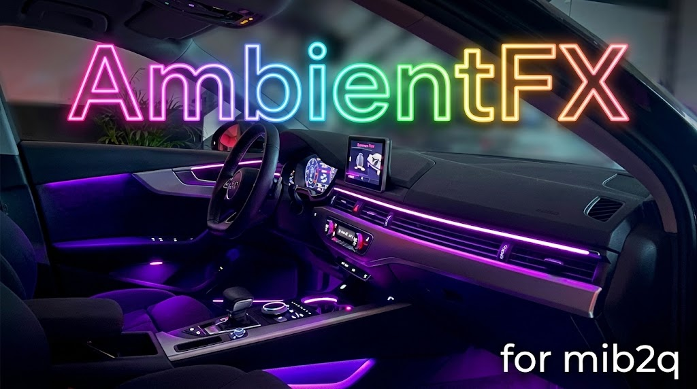

# mib2q-ambient-fx – AmbientFX für Audi MHI2Q (MU1329)

🇩🇪 **Deutsch** (diese Seite oben) · 🇬🇧 [English version below](#english)

> [!CAUTION]
> **Nur zu Test- und Entwicklungszwecken auf privatem Grundstück – nicht im öffentlichen Straßenverkehr.**
> Dieses Projekt ist **nicht** von Audi/VW freigegeben, hat **keine** Betriebserlaubnis/Bauartgenehmigung und ist im Straßenverkehr **womöglich nicht zulässig** (StVO/StVZO, Details: [docs/RECHT_LEGAL.md](docs/RECHT_LEGAL.md)).
> Es greift in die HMI-Software deines Steuergeräts ein. **Nutzung auf eigene Gefahr, nur für den privaten Gebrauch.** Es gibt keine Gewährleistung und keine Haftung.

> [!IMPORTANT]
> Entwickelt und getestet nur auf **einem** Fahrzeug (Audi A4 B9) mit **MHI2Q / MU1329**. Andere Geräte, andere Firmware-Stände und andere Fahrzeuge sind **ungetestet**.

## Worum geht es

AmbientFX erweitert im Audi-MMI das Menü **Fahrzeugeinstellungen → Ambientebeleuchtung** (hinter „Audi drive select“) um zusätzliche, fahrzeugreaktive Licht-Effekte. Es ist ein Java-Patch für das MHI2Q (HMI „lsd“), der als zusätzliche Jar im Bootclasspath **vor** der originalen HMI geladen wird – die Original-Dateien des Geräts bleiben unverändert.

Alle Effekte steuern nur die **Kontur/Linie** der Ambientebeleuchtung. Die **Fläche** bleibt beim normalen Farbregler im MMI.

| Effekt | Verhalten |
|---|---|
| **Momentum** | Farbe folgt dem Tempo (0–130 km/h in 10-km/h-Stufen, weich überblendet, 0 und 130 km/h = Rot), Helligkeit folgt dem Gaspedal, Bremsen = sofort Werks-Rot. Wechsel D → S am Gangwahlhebel: sofort Weiß 100 %, 1 s halten, 2 s in die normale Farbe ausblenden (nicht im Dynamic-Profil). |
| **Momentum select** | Wie Momentum, aber mit eigener Farbwelt je Audi-drive-select-Profil. |
| **Atmosphere** | Ruhig, nicht fahrreaktiv: Farbton nach Außentemperatur (kalt = Blau, warm = Amber), langsames „Atmen“. |
| **Scroll** | Regenbogen-Showeffekt, Drehgeschwindigkeit proportional zum Tempo. |
| **Drive** | Gaspedal und Lenkwinkel steuern Farbton, Sättigung und Helligkeit. |

Die Farben stammen **zur Laufzeit aus der Werksfarbliste, die das Fahrzeug selbst meldet** – im Repository sind keine Farbwerte oder Daten des Fahrzeugs hinterlegt.

## Eigene Designs selbst erstellen

Ein Effekt ist eine kleine Java-Klasse mit drei Methoden (`start`, `tick`, `periodMs`) und wird als **`.ambiente`-Plugin** gebaut, ohne das Haupt-Jar zu ändern. Schritt für Schritt: **[docs/EIGENE-DESIGNS_CUSTOM-DESIGNS.md](docs/EIGENE-DESIGNS_CUSTOM-DESIGNS.md)**, dazu ein lauffähiges Beispiel in [`examples/MeinEffekt.java`](examples/MeinEffekt.java) und das ausführliche [Handbuch für eigene Effekte](EFFEKTE_HANDBUCH.md) (Deutsch).

**Neu, experimentell: das [Design Studio](designer/README.md).** Ein Editor im Browser (eine einzige HTML-Datei, läuft offline), mit dem du Designs **ohne Programmieren** neu erstellst, importierst, bearbeitest und als `.ambiente` exportierst, mit Live-Vorschau, dunklem Design, Deutsch/Englisch. Online: https://matze89x.github.io/mib2q-ambient-fx/designer/ (sobald GitHub Pages aktiv ist), sonst [`docs/designer/index.html`](docs/designer/index.html) herunterladen und im Browser öffnen. **Bisher nur am PC getestet, noch nicht im Fahrzeug.**

## Was dieses Repository nicht enthält

- **Keinen Audi-/VW-/e.solutions-Code und keine Firmware.** Die drei Original-Klassen, die AmbientFX ersetzt, werden **nicht** mitgeliefert. Du erzeugst sie selbst aus **deiner eigenen** `lsd.jar` (`tools/decompile_stock.sh`), das Repository enthält nur die kleinen Änderungen als Patch-Dateien (`patches/`).
- **Keine fertig gebauten Jars/Plugins** und keine Binärdateien. Du baust alles selbst.
- **Keine Fahrzeugdaten:** keine Fahrgestellnummer, keine Logs, keine Dumps, keine Farbwerte, keine Zugangsdaten, keine persönlichen Daten.
- **Keine Anleitung zum Freischalten** von Telnet, Konsole oder dem Green Engineering Menu und keine Signatur-Umgehung. Wer das Gerät dafür vorbereiten muss, nutzt dafür die jeweiligen Community-Projekte (zum Beispiel die M.I.B. More Incredible Bash Toolbox).

Dieses Repository enthält nur eigenen Code, eigene Skripte und eigene Dokumentation.

## Voraussetzungen

- **Ein Fahrzeug mit farbiger Ambientebeleuchtung** (Sonderausstattung, beim Testfahrzeug PR-Nr. QQ2). Im MMI muss es unter *MENU › Fahrzeug › Fahrzeugeinstellungen › Ambientebeleuchtung* Farbwahl bzw. Profile (individuell / Audi drive select) geben. AmbientFX steuert nur die Farbe der **Kontur** dieser vorhandenen Beleuchtung. Ohne farbige Ambientebeleuchtung gibt es nichts zu steuern.
- Audi MHI2Q (MU1329), ein Steuergerät-Zugang, den du selbst eingerichtet hast (Telnet **oder** Toolbox mit Green Engineering Menu). Beides ist nicht Teil dieses Projekts.
- Mac oder Linux mit **JDK 8** (Java-1.2-Bytecode), `bash`, `patch`, `unzip`, `python3`.
- **Deine eigene `lsd.jar`**: die `lsd.jxe` deines Geräts, mit einem JXE→JAR-Konverter (z. B. dem Community-Werkzeug *jxe2jar*) umgewandelt.
- Zum Decompilieren: [Vineflower 1.12.0](https://github.com/Vineflower/vineflower/releases/tag/1.12.0) (braucht Java 17+) und zwei kleine OSGi-Bibliotheken aus Maven Central.

Alle Schritte stehen in **[docs/BAUEN_BUILD.md](docs/BAUEN_BUILD.md)**.

## Schnellstart

```bash
# 1. Quellen vorbereiten (deine lsd.jar, Vineflower und OSGi-Jars liegen unter vendor/, siehe docs/BAUEN_BUILD.md)
VF_JAVA=/pfad/zu/java17/bin/java tools/decompile_stock.sh
tools/prepare_sources.sh

# 2. Bauen und prüfen
./build_java.sh          # -> build/ambient_fx.jar
./verify.sh              # Bytecode-Vergleich mit dem Original: nur erwartete Abweichungen
tools/build_all_plugins.sh   # -> build/plugins/*.ambiente
```

Installiert wird **immer die Jar und alle Plugins zusammen**. Wege: **SD-Menü im Green Engineering Menu** (`deploy/build_sd_package.sh`, mit Sicherung auf die SD) oder **Telnet** (`DEPLOY_TELNET.md`). Siehe **[docs/INSTALLATION_INSTALL.md](docs/INSTALLATION_INSTALL.md)**.

## Deinstallieren / Wiederherstellen

Das SD-Menü hat den Punkt **Deinstallieren**: Es sichert zuerst alles auf die SD und entfernt dann nur die AmbientFX-Dateien (Jar, Plugins, den gemerkten Effekt). Danach ist die Ambientebeleuchtung wieder im Originalzustand. Per Telnet genügt: `ambient_fx.jar` und den Ordner `ambientfx_effects` löschen und neu starten. Details in [docs/INSTALLATION_INSTALL.md](docs/INSTALLATION_INSTALL.md).

## Was geprüft ist – und was nicht

- ✅ Im Fahrzeug (Audi A4 B9, MU1329): Momentum läuft auch im Fahrbetrieb unauffällig, Menü-Einträge, Plugin-System, Installation und Deinstallation über das SD-Menü.
- ⚠️ Momentum select im Dunkeln, und die genauen Farbübergänge auf anderen LED-Streifen sind nur teilweise im Fahrzeug bestätigt.
- ❌ Andere Fahrzeuge, andere Firmware: **ungetestet**. Das Skript `verify.sh` meldet, wenn eine ersetzte Klasse in deiner Firmware nicht passt. Dann **nicht installieren**.

## Dokumentation

| Datei | Inhalt |
|---|---|
| [docs/BAUEN_BUILD.md](docs/BAUEN_BUILD.md) | Voraussetzungen und Bauen (DE/EN) |
| [docs/INSTALLATION_INSTALL.md](docs/INSTALLATION_INSTALL.md) | Installieren, Deinstallieren, Wiederherstellen (DE/EN) |
| [docs/EIGENE-DESIGNS_CUSTOM-DESIGNS.md](docs/EIGENE-DESIGNS_CUSTOM-DESIGNS.md) | Eigene Effekte erstellen (DE/EN) |
| [docs/RECHT_LEGAL.md](docs/RECHT_LEGAL.md) | Straßenverkehr, StVO/StVZO, Haftung (DE/EN) |
| [docs/TECHNIK.md](docs/TECHNIK.md) | Technische Details: Aufbau, Analyse, Effekte (Deutsch) |
| [EFFEKTE_HANDBUCH.md](EFFEKTE_HANDBUCH.md) | Ausführliches Handbuch für eigene Effekte (Deutsch) |
| [SD-ANLEITUNG.md](SD-ANLEITUNG.md), [TEST-ABLAUF.md](TEST-ABLAUF.md) | SD-Menü im Green Engineering Menu (Deutsch) |
| [DEPLOY_TELNET.md](DEPLOY_TELNET.md) | Weg per Telnet (Deutsch) |
| [docs/DEBUG.md](docs/DEBUG.md) | Debug-Protokoll nur im RAM, Marker, Obergrenze (DE/EN) |
| [designer/README.md](designer/README.md) | Design Studio: Designs im Browser bauen, Format, Prüfung (DE/EN) |

## Debug

AmbientFX kann ein **Protokoll nur im RAM** führen, das du per Telnet ausliest. Es ist **standardmäßig aus** und wird nur mit der Marker-Datei `/mnt/persist/ambientfx/debug` eingeschaltet (`touch`, bleibt nach dem Neustart erhalten, bis du sie mit `rm` löschst). Das Protokoll (`/dev/shmem/ambientfx.log`) ist nach jedem Neustart weg, hat eine **feste Obergrenze von 256 KB pro Start** (danach Stopp, nichts wird rotiert oder gelöscht) und sendet **nichts** über ein Netz. Ohne Marker wird nichts geschrieben. Einzelheiten: [docs/DEBUG.md](docs/DEBUG.md).

## Roadmap

- **Design Studio erweitern** (mehr Bausteine, etwa Gang-abhängige Regeln oder Zonen), nach dem ersten Test im Fahrzeug. Ideen und Mithilfe willkommen.
- Weitere Ideen: Einparkhilfe-Effekt, Blinker-Impuls, Helligkeit je Zone.
- Englische Übersetzung der technischen Detail-Dokumente.

## Mitmachen

Eigene Effekte, Tests auf anderen Geräten und Korrekturen sind willkommen (Issue oder Pull Request). **Bitte keine Firmware, keine Audi-Dateien, keine Fahrgestellnummern, keine Logs mit persönlichen Daten und keine Zugangsdaten hochladen.**

## Lizenz, Marken, Credits

- Lizenz: [LICENSE.md](LICENSE.md) – Namensnennung Pflicht, **keine kommerzielle Nutzung, kein Verkauf**, Weitergabe unter gleichen Bedingungen. Sie gilt für den eigenen Code, die Skripte und die Dokumentation, **nicht** für Audi-/Drittanbieter-Code.
- Audi, Volkswagen, MMI und alle weiteren Marken gehören ihren jeweiligen Inhabern. Dies ist ein unabhängiges Community-Projekt ohne Verbindung zu Audi/VW.
- © 2026 Matze89x in cooperation with [DEB](https://www.digital-eliteboard.com/) and [LuKa_dev](https://github.com/luka-dev).
- Inspiriert von **[LuKa_dev](https://github.com/luka-dev)**: Ideen zu Drive und Scroll sowie der Bootclasspath-Mechanismus stammen aus dessen Patches. Über sein Projekt [mib2q-carplay-rgi](https://github.com/luka-dev/mib2q-carplay-rgi) sind wir überhaupt auf diesen Ansatz gekommen. Danke!

---

<a id="english"></a>

# mib2q-ambient-fx – AmbientFX for Audi MHI2Q (MU1329)

🇩🇪 [Deutsche Version oben](#mib2q-ambient-fx--ambientfx-für-audi-mhi2q-mu1329) · 🇬🇧 **English** (English version of the German text above)

> [!CAUTION]
> **For testing and development only, on private property – not on public roads.**
> This project is **not** approved by Audi/VW, has **no** type approval or operating licence, and **may not be permitted** in road traffic (German StVO/StVZO, details: [docs/RECHT_LEGAL.md](docs/RECHT_LEGAL.md)).
> It modifies the HMI software of your head unit. **Use at your own risk, for private use only.** No warranty, no liability.

> [!IMPORTANT]
> Developed and tested on **one** vehicle only (Audi A4 B9) with **MHI2Q / MU1329**. Other units, other firmware versions and other vehicles are **untested**.

## What it is

AmbientFX adds extra, vehicle-reactive light effects to the Audi MMI menu **Vehicle settings → Ambient lighting** (after “Audi drive select”). It is a Java patch for the MHI2Q (HMI “lsd”): an additional jar loaded on the bootclasspath **before** the original HMI – the unit’s original files stay untouched.

All effects only drive the **contour/line** of the ambient lighting. The **surface** stays with the normal colour control in the MMI.

| Effect | Behaviour |
|---|---|
| **Momentum** | Colour follows speed (0–130 km/h in 10 km/h steps, smoothly blended, red at 0 and at 130 km/h), brightness follows the throttle, braking = instant factory red. Gear lever D → S: instant white at 100 %, hold 1 s, fade into the normal colour over 2 s (not in Dynamic profile). |
| **Momentum select** | Like Momentum, with its own colour world per Audi drive select profile. |
| **Atmosphere** | Calm, not driving-reactive: hue follows outside temperature (cold = blue, warm = amber), slow “breathing”. |
| **Scroll** | Rainbow show effect, rotation speed proportional to speed. |
| **Drive** | Throttle and steering angle drive hue, saturation and brightness. |

Colours are taken **at runtime from the factory colour list the vehicle itself reports** – the repository contains no colour values or other data from the vehicle.

## Make your own designs

An effect is a small Java class with three methods (`start`, `tick`, `periodMs`), built as a **`.ambiente` plugin** without touching the main jar. Step by step: **[docs/EIGENE-DESIGNS_CUSTOM-DESIGNS.md](docs/EIGENE-DESIGNS_CUSTOM-DESIGNS.md)**, a working example in [`examples/MeinEffekt.java`](examples/MeinEffekt.java), and the detailed [effects handbook](EFFEKTE_HANDBUCH.md) (German).

**New, experimental: the [Design Studio](designer/README.md).** An editor in your browser (one single HTML file, works offline) to **create, import, edit** and **export** designs as `.ambiente` **without programming**, with live preview, dark design, German/English. Online: https://matze89x.github.io/mib2q-ambient-fx/designer/ (once GitHub Pages is enabled), otherwise download [`docs/designer/index.html`](docs/designer/index.html) and open it in a browser. **Tested on a computer so far, not yet in a vehicle.**

## What this repository does not contain

- **No Audi/VW/e.solutions code and no firmware.** The three original classes AmbientFX replaces are **not** shipped. You generate them yourself from **your own** `lsd.jar` (`tools/decompile_stock.sh`); the repository only contains the small changes as patch files (`patches/`).
- **No pre-built jars/plugins** and no binaries. You build everything yourself.
- **No vehicle data:** no VIN, no logs, no dumps, no colour values, no credentials, no personal data.
- **No instructions to unlock** telnet, the console or the Green Engineering Menu, and no signature bypass. Use the respective community projects for that (for example the M.I.B. More Incredible Bash toolbox).

This repository contains only original code, scripts and documentation.

## Requirements

- **A vehicle with coloured ambient lighting** (optional equipment, PR no. QQ2 on the test vehicle). The MMI must offer colour choice or profiles (individual / Audi drive select) under *MENU › Fahrzeug › Fahrzeugeinstellungen › Ambientebeleuchtung* (German MMI wording). AmbientFX only drives the colour of the **contour** of that existing lighting. Without coloured ambient lighting there is nothing to control.
- Audi MHI2Q (MU1329) and a way into the unit that you set up yourself (telnet **or** toolbox with Green Engineering Menu). Neither is part of this project.
- Mac or Linux with **JDK 8** (Java 1.2 bytecode), `bash`, `patch`, `unzip`, `python3`.
- **Your own `lsd.jar`**: the `lsd.jxe` of your unit, converted with a JXE→JAR converter (e.g. the community tool *jxe2jar*).
- For decompiling: [Vineflower 1.12.0](https://github.com/Vineflower/vineflower/releases/tag/1.12.0) (needs Java 17+) and two small OSGi libraries from Maven Central.

All steps are in **[docs/BAUEN_BUILD.md](docs/BAUEN_BUILD.md)**.

## Quick start

```bash
# 1. Prepare sources (your lsd.jar, Vineflower and the OSGi jars go to vendor/, see docs/BAUEN_BUILD.md)
VF_JAVA=/path/to/java17/bin/java tools/decompile_stock.sh
tools/prepare_sources.sh

# 2. Build and verify
./build_java.sh          # -> build/ambient_fx.jar
./verify.sh              # bytecode comparison with the original: only expected differences
tools/build_all_plugins.sh   # -> build/plugins/*.ambiente
```

**Always install the jar and all plugins together.** Ways: **SD menu in the Green Engineering Menu** (`deploy/build_sd_package.sh`, with backup to the SD card) or **telnet** (`DEPLOY_TELNET.md`). See **[docs/INSTALLATION_INSTALL.md](docs/INSTALLATION_INSTALL.md)**.

## Uninstall / recover

The SD menu has an **Uninstall** entry: it backs everything up to the SD card first, then removes only the AmbientFX files (jar, plugins, the remembered effect). Afterwards the ambient lighting is back to stock. Via telnet it is enough to delete `ambient_fx.jar` and the folder `ambientfx_effects`, then reboot. Details in [docs/INSTALLATION_INSTALL.md](docs/INSTALLATION_INSTALL.md).

## What is verified – and what is not

- ✅ In the vehicle (Audi A4 B9, MU1329): Momentum runs unobtrusively while driving, menu entries, plugin system, install and uninstall through the SD menu.
- ⚠️ Momentum select at night, and the exact colour transitions on other LED strips are only partly confirmed in the vehicle.
- ❌ Other vehicles, other firmware: **untested**. `verify.sh` reports when a replaced class does not match your firmware. In that case **do not install**.

## Documentation

| File | Content |
|---|---|
| [docs/BAUEN_BUILD.md](docs/BAUEN_BUILD.md) | Requirements and build (DE/EN) |
| [docs/INSTALLATION_INSTALL.md](docs/INSTALLATION_INSTALL.md) | Install, uninstall, recover (DE/EN) |
| [docs/EIGENE-DESIGNS_CUSTOM-DESIGNS.md](docs/EIGENE-DESIGNS_CUSTOM-DESIGNS.md) | Create your own effects (DE/EN) |
| [docs/RECHT_LEGAL.md](docs/RECHT_LEGAL.md) | Road traffic, StVO/StVZO, liability (DE/EN) |
| [docs/TECHNIK.md](docs/TECHNIK.md) | Technical details: structure, analysis, effects (German) |
| [EFFEKTE_HANDBUCH.md](EFFEKTE_HANDBUCH.md) | Detailed handbook for your own effects (German) |
| [SD-ANLEITUNG.md](SD-ANLEITUNG.md), [TEST-ABLAUF.md](TEST-ABLAUF.md) | SD menu in the Green Engineering Menu (German) |
| [DEPLOY_TELNET.md](DEPLOY_TELNET.md) | Telnet route (German) |
| [docs/DEBUG.md](docs/DEBUG.md) | Debug log in RAM only, marker, size limit (DE/EN) |
| [designer/README.md](designer/README.md) | Design Studio: build designs in the browser, format, verification (DE/EN) |

## Debug

AmbientFX can keep a **log in RAM only** that you read via telnet. It is **off by default** and is only enabled by the marker file `/mnt/persist/ambientfx/debug` (`touch`; it survives a reboot until you delete it with `rm`). The log (`/dev/shmem/ambientfx.log`) is gone after every reboot, has a **hard limit of 256 KB per boot** (then it stops; nothing is rotated or deleted) and sends **nothing** over any network. Without the marker nothing is written. Details: [docs/DEBUG.md](docs/DEBUG.md).

## Roadmap

- **Extend the Design Studio** (more building blocks, e.g. gear-dependent rules or zones), after the first test in a vehicle. Ideas and help welcome.
- More ideas: parking-distance effect, indicator pulse, brightness per zone.
- English translation of the technical detail documents.

## Contributing

Your own effects, tests on other units and fixes are welcome (issue or pull request). **Please do not upload firmware, Audi files, VINs, logs with personal data or credentials.**

## License, trademarks, credits

- License: [LICENSE.md](LICENSE.md) – attribution required, **no commercial use, no selling**, share-alike. It covers the original code, scripts and documentation, **not** Audi/third-party code.
- Audi, Volkswagen, MMI and all other trademarks belong to their respective owners. This is an independent community project with no connection to Audi/VW.
- © 2026 Matze89x in cooperation with [DEB](https://www.digital-eliteboard.com/) and [LuKa_dev](https://github.com/luka-dev).
- Inspired by **[LuKa_dev](https://github.com/luka-dev)**: the ideas for Drive and Scroll and the bootclasspath mechanism come from his patches. It was his project [mib2q-carplay-rgi](https://github.com/luka-dev/mib2q-carplay-rgi) that led us to this approach in the first place. Thank you!
